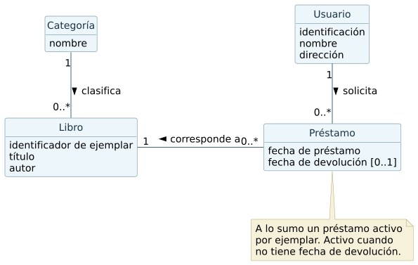

# Gestión de una biblioteca

## Alcance y clases

La biblioteca necesita registrar su catálogo, los usuarios y el historial de préstamos. Un usuario registrado puede pedir un libro disponible.

| Clase | Datos |
| --- | --- |
| Libro | Identificador interno, título y autor. Se representa cada ejemplar que se puede prestar. |
| Categoría | Nombre de la clasificación, por ejemplo Ciencia o Historia. |
| Usuario | Número de identificación, nombre y dirección. |
| Préstamo | Fecha de préstamo. Se incorpora una fecha de devolución opcional para distinguir un préstamo activo de uno devuelto. |

## Asociaciones y reglas

- Cada libro pertenece a una categoría. Una categoría puede tener de cero a muchos libros.
- Cada préstamo corresponde a un libro y a un usuario registrado. Un libro y un usuario pueden tener varios préstamos históricos.
- Un préstamo se considera activo mientras no tenga fecha de devolución. Cada libro tiene a lo sumo un préstamo activo. Esta condición impide una segunda solicitud activa para el mismo libro, incluso si la hace el mismo usuario.
- El número de identificación distingue a los usuarios. El identificador interno distingue ejemplares aunque compartan título y autor.
- Si se registra una devolución, su fecha es igual o posterior a la de préstamo. La disponibilidad se deduce de los préstamos activos.

## Escenario para solicitar un préstamo

1. El usuario indica su identificación y el libro solicitado.
2. El sistema comprueba que el usuario y el ejemplar existan.
3. El sistema comprueba que el ejemplar esté disponible.
4. Se registra un préstamo con la fecha y se confirma la operación.

Si el usuario o el ejemplar no existen, se informa qué dato debe revisarse. Si existe un préstamo activo del libro, se rechaza la solicitud sin crear otro registro. Cuando se registra una devolución, el historial se conserva y el ejemplar queda disponible para un nuevo préstamo.

## Ejemplo de comprobación

| Situación | Resultado esperado |
| --- | --- |
| Ana pide un ejemplar disponible. | Se registra un préstamo activo a nombre de Ana. |
| Ana vuelve a pedir ese ejemplar mientras lo tiene. | Se rechaza el duplicado y queda un único préstamo activo. |
| Otro usuario pide ese mismo ejemplar antes de la devolución. | Se informa que el ejemplar está prestado. |
| Se devuelve el ejemplar y luego se pide nuevamente. | Se conserva el préstamo devuelto y se crea uno activo. |

El enunciado menciona préstamos y disponibilidad. La identificación de ejemplares y la fecha de devolución son decisiones de modelado que permiten manejar copias y conservar el historial.
