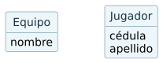
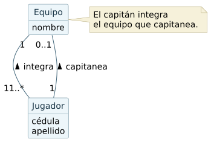
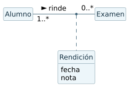
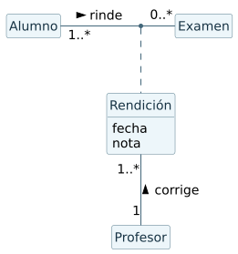
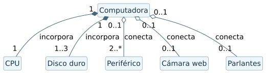
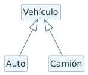
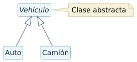
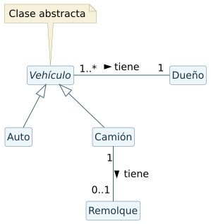
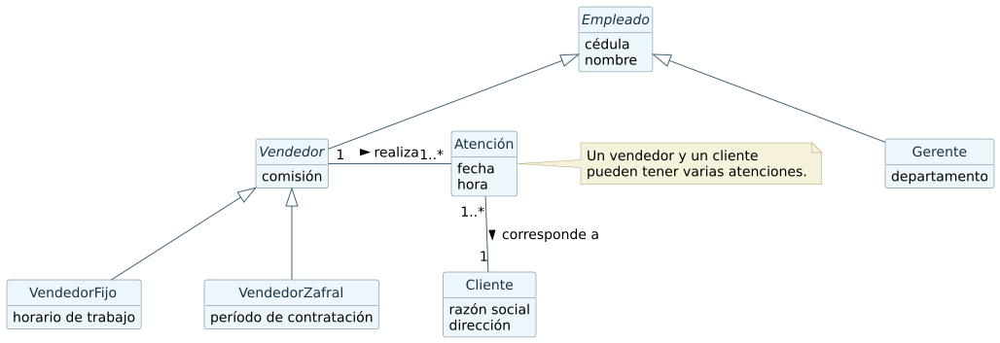

# Preguntas de análisis orientado a objetos

## 1. Etapa de análisis y diagrama conceptual

En el análisis orientado a objetos se estudia el problema para reconocer qué información y qué relaciones necesita representar el sistema. El diagrama de clases conceptual muestra las clases del dominio, sus atributos, las asociaciones, las multiplicidades y las restricciones. Sirve para revisar con quienes conocen el problema que el modelo refleje las reglas del dominio antes de decidir cómo programarlo.

## 2. Documento de partida

El documento de requerimientos es el punto de partida. Reúne el alcance, los usuarios, lo que debe permitir el sistema y las reglas del problema. También se puede consultar el glosario para comprobar que los términos del modelo tengan un significado compartido.

## 3. Equipo y jugador

El Equipo tiene nombre. Del Jugador interesan la cédula y el apellido. En este primer dibujo figuran las dos clases y sus atributos.

## 4. Integrantes y capitanes

Cada Jugador integra un Equipo y cada Equipo tiene once o más jugadores. Un Jugador puede capitanear cero o un equipo. Cada Equipo tiene exactamente un capitán.

## 5. Restricción de capitanía

El capitán de un equipo debe integrar ese mismo equipo. Las dos multiplicidades controlan cantidades por separado. La restricción vincula ambas asociaciones para evitar que un jugador capitanee a un equipo distinto al suyo.

## 6. Exámenes y rendiciones

Cada Alumno rinde cero o más exámenes. Cada Examen es rendido por uno o más alumnos. La clase de asociación Rendición guarda la fecha y la nota porque esos datos corresponden al encuentro de un alumno con un examen concreto. Si hubiera varios intentos de una misma instancia, habría que distinguir cada intento en el modelo.

## 7. Corrección de la rendición

Se incorpora Profesor y se lo asocia con Rendición. Cada rendición tiene un solo profesor corrector. Se interpreta que un profesor registrado como corrector tiene una o más rendiciones a cargo. La corrección se asigna por alumno y examen. Dos alumnos del mismo examen pueden tener el mismo profesor corrector o profesores distintos.

## 8. Partes de una computadora

Se modelan CPU y discos como partes internas instaladas de la Computadora. La composición expresa que, dentro del inventario de la computadora, cada instancia instalada pertenece a un solo conjunto. Se usa agregación para los periféricos, la cámara y los parlantes, que se pueden desconectar. La cámara web y el conjunto de parlantes se consideran extras aparte del mínimo de dos periféricos.

## 9. Vehículo, Auto y Camión

Auto y Camión son especializaciones de Vehículo. Con Vehículo como clase concreta pueden existir vehículos genéricos que no sean autos ni camiones.

## 10. Vehículo abstracto

Una clase abstracta no se instancia directamente. Con los dos subtipos concretos que aparecen en el dibujo, cada vehículo representado será un auto o un camión.

## 11. Dueño y remolque

Cada Vehículo tiene un Dueño y cada Dueño tiene uno o más vehículos. Por herencia, la asociación con Dueño vale para Auto y Camión. La asociación con Remolque se declara en Camión. Cada Camión tiene cero o un remolque y cada Remolque está asociado a un Camión. Auto carece de esa relación y el Vehículo abstracto carece de instancias directas.

## 12. Gerentes, vendedores y clientes

Empleado reúne cédula y nombre. Gerente agrega departamento. Vendedor reúne la comisión y se especializa en VendedorFijo, con horario de trabajo, y VendedorZafral, con período de contratación. De Cliente se registra razón social y dirección.

Cada Atención relaciona exactamente a un vendedor con un cliente y guarda la fecha y la hora. Se la modela como una clase con identidad propia para poder registrar varias atenciones entre el mismo vendedor y el mismo cliente. Cada vendedor registrado atiende al menos a un cliente. Se interpreta que cada cliente tiene uno o más vendedores distintos y que puede tener varios. Si el dominio exige que «muchos» signifique dos como mínimo, esa regla se ajusta a dos vendedores distintos.

## Reflexión del capítulo 2.3.1, p. 14

Una generalización expresa una relación de tipos. Toda instancia de Adscripto también es Profesor, mientras que una instancia de Profesor puede quedar fuera de Adscripto. Con respecto a una subclase determinada, la misma instancia pertenece a esa subclase o queda fuera de ella. Por eso en la generalización UML se usa el triángulo hacia la superclase y se omiten las multiplicidades propias de las asociaciones entre objetos.
