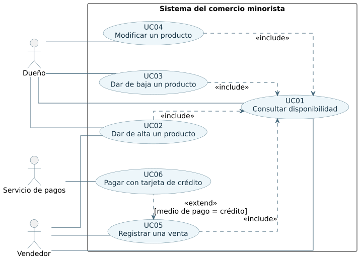

# Casos de uso del comercio

## c. Identificación y diagrama

| ID | Caso de uso | Actor principal | Relación UML |
| --- | --- | --- | --- |
| UC01 | Consultar disponibilidad | Dueño o Vendedor | Se ejecuta directamente o como paso obligatorio de las otras operaciones con productos. |
| UC02 | Dar de alta un producto | Dueño o Vendedor | Incluye UC01. |
| UC03 | Dar de baja un producto | Dueño | Incluye UC01. |
| UC04 | Modificar un producto | Dueño | Incluye UC01. |
| UC05 | Registrar una venta | Vendedor | Incluye UC01 por cada código y recibe la extensión UC06 si se paga con crédito. |
| UC06 | Pagar con tarjeta de crédito | Vendedor, con el servicio de pagos como actor de apoyo | Extiende UC05 en Cobro con crédito. |

## d. Escenarios principales

| Caso | Escenario principal |
| --- | --- |
| UC01 | El usuario consulta A023. El sistema encuentra un producto activo e informa que está disponible. |
| UC02 | El vendedor quiere agregar B054. El sistema verifica que el código no existe. El vendedor ingresa descripción y costo, confirma y el producto queda activo. |
| UC03 | El dueño indica A023. El sistema verifica que está activo, muestra sus datos y, con la confirmación del dueño, lo da de baja. |
| UC04 | El dueño indica B054. El sistema comprueba que está activo. El dueño corrige la descripción o el precio y guarda los cambios. |
| UC05 | El vendedor ingresa el identificador del cliente y los códigos A023 y B054. El sistema verifica los productos, presenta la operación y la registra al confirmarla. |
| UC06 | El vendedor elige tarjeta de crédito para una venta pendiente. El servicio valida la tarjeta y autoriza el importe. El resultado aprobado vuelve a UC05. |

## e. Desarrollo expandido

### UC01 · Consultar disponibilidad

| Campo | Detalle |
| --- | --- |
| Actores | Dueño o Vendedor. |
| Precondiciones | El usuario tiene uno de los roles habilitados y conoce el código. |
| Poscondiciones | Se devuelve uno de tres estados, disponible, inactivo o inexistente. El catálogo queda igual. |
| Inclusiones | Ninguna. |
| Puntos de extensión | Ninguno. |

**Flujo principal**

1. El actor ingresa el código.
2. El sistema verifica que el código esté presente y busca coincidencia exacta en el catálogo.
3. El sistema encuentra un producto activo e informa que está disponible.

**Flujos alternativos**

- 2a. Si el código está vacío, se solicita uno válido y se retoma el paso 1.
- 3a. Si el producto existe y está inactivo, el sistema lo informa.
- 3b. Si el código es nuevo, el sistema informa que es inexistente.
- 3c. Si no se puede consultar el catálogo, se informa un error de consulta. Si se llamó a UC01 desde otra operación, esta queda pendiente hasta poder verificar el código.

### UC02 · Dar de alta un producto

| Campo | Detalle |
| --- | --- |
| Actores | Dueño o Vendedor. |
| Precondiciones | El actor tiene permiso de alta y cuenta con el código que trae el producto. |
| Poscondiciones | Se registra el código único con descripción y precio inicial de costo. El producto queda disponible. Si falla, no se agrega. |
| Inclusiones | UC01 en Verificar código nuevo, paso 2. |
| Puntos de extensión | Ninguno. |

**Flujo principal**

1. El actor solicita el alta e ingresa el código.
2. El sistema ejecuta UC01 y confirma que el código es inexistente.
3. El actor escribe la descripción y el precio de costo.
4. El sistema valida los datos y presenta el alta para confirmar.
5. El actor confirma y el sistema guarda el producto como activo.

**Flujos alternativos**

- 2a. Si el código existe como activo o inactivo, se informa que está registrado y se permite ingresar otro. No se sobrescribe el registro.
- 2b. Si UC01 no puede determinar el estado, se suspende el alta.
- 4a. Si falta la descripción o el precio no es un importe válido, el actor corrige los datos.
- 5a. Si el actor cancela o el guardado falla, el producto queda sin registrar.

### UC03 · Dar de baja un producto

| Campo | Detalle |
| --- | --- |
| Actores | Dueño. |
| Precondiciones | El actor tiene el rol Dueño y conoce el código. |
| Poscondiciones | El producto queda inactivo y las ventas anteriores lo siguen referenciando. Si la operación falla, se mantiene el estado previo. |
| Inclusiones | UC01 en Verificar producto, paso 2. |
| Puntos de extensión | Ninguno. |

**Flujo principal**

1. El dueño solicita la baja e ingresa el código.
2. El sistema ejecuta UC01 y comprueba que está disponible.
3. El sistema muestra los datos del producto y pide confirmación.
4. El dueño confirma. El sistema marca el producto como inactivo e informa el resultado.

**Flujos alternativos**

- 2a. Si el código es inexistente o el producto ya está inactivo, se informa y no se registra otra baja.
- 2b. Si no se puede consultar el catálogo, se suspende la operación.
- 4a. Si el dueño cancela o la actualización falla, se mantiene el estado anterior.

### UC04 · Modificar un producto

| Campo | Detalle |
| --- | --- |
| Actores | Dueño. |
| Precondiciones | El actor tiene el rol Dueño y conoce el código. |
| Poscondiciones | Se guarda la descripción o el precio actualizado. El código se conserva. |
| Inclusiones | UC01 en Verificar producto, paso 2. |
| Puntos de extensión | Ninguno. |

**Flujo principal**

1. El dueño indica el código del producto que quiere modificar.
2. El sistema ejecuta UC01 y comprueba que el producto está disponible.
3. El sistema muestra su descripción y su precio vigentes.
4. El dueño cambia uno o ambos datos. El sistema verifica que sean válidos y pide confirmación.
5. El dueño confirma. El sistema guarda los nuevos datos e informa el cambio.

**Flujos alternativos**

- 2a. Si el producto es inexistente o inactivo, se informa y la modificación se detiene.
- 2b. Si no se puede consultar el catálogo, se suspende la operación.
- 4a. Si el dato nuevo es inválido, el dueño lo corrige y se retoma el paso 4.
- 5a. Si el dueño cancela o el guardado falla, se conservan los datos anteriores.

### UC05 · Registrar una venta

| Campo | Detalle |
| --- | --- |
| Actores | Vendedor. El servicio de pagos puede intervenir mediante UC06. |
| Precondiciones | El actor tiene el rol Vendedor y el cliente aporta CI o RUC. |
| Poscondiciones | Se registra la venta con la identificación y los códigos comprados. Si corresponde a crédito, se cuenta con una autorización. Si falla antes de completar el registro, no se considera una venta realizada. |
| Inclusiones | UC01 en Verificar productos, paso 3 y para los códigos que se sustituyan. |
| Puntos de extensión | Cobro con crédito, paso 5. UC06 se activa si el medio de pago elegido es tarjeta de crédito. |

**Flujo principal**

1. El vendedor inicia una venta e indica el tipo y número de identificación del cliente.
2. Ingresa los códigos de uno o más productos.
3. El sistema ejecuta UC01 por cada código y verifica que todos estén disponibles.
4. El sistema presenta el detalle con el importe de la operación.
5. El vendedor indica el medio de pago. En este escenario no se usa tarjeta de crédito.
6. El vendedor confirma la venta. El sistema la registra y muestra el resultado.

**Flujos alternativos**

- 1a. Si falta la identificación, se solicita completar ese dato.
- 3a. Si algún código no está disponible, el vendedor lo retira o lo sustituye. Se vuelve al paso 2 y se requiere al menos un producto disponible para seguir.
- 3b. Si falla la consulta de disponibilidad, se detiene el registro hasta poder comprobar los códigos.
- 5a. Si el cliente elige tarjeta de crédito, se ejecuta UC06. Con autorización, se continúa en el paso 6. Si se rechaza o no se confirma, se permite elegir otro medio o dejar pendiente la operación según el resultado.
- 6a. Si se cancela antes de un cobro aprobado, se descarta el registro.
- 6b. Si el pago fue autorizado y falla el registro, la operación debe quedar identificada para verificar o conciliar el cobro antes de reintentar. No se da por realizada ni se vuelve a cobrar automáticamente.

### UC06 · Pagar con tarjeta de crédito

| Campo | Detalle |
| --- | --- |
| Actores | Vendedor y servicio de pagos. |
| Precondiciones | Hay una venta pendiente con productos comprobados, importe calculado y pago por tarjeta de crédito seleccionado. |
| Poscondiciones | El caso de venta recibe autorización para ese importe o un resultado que indica por qué no puede finalizarse por crédito. |
| Inclusiones | Ninguna. La validación y autorización son pasos de este caso. |
| Puntos de extensión | Ninguno propio. Extiende UC05 en Cobro con crédito. |

**Flujo principal**

1. El vendedor inicia el cobro con tarjeta para el importe de la venta.
2. El sistema solicita al servicio de pagos la validación de la tarjeta.
3. El servicio confirma la validez y el sistema solicita autorización por el importe.
4. El servicio aprueba el pago e informa la referencia de autorización.
5. El sistema devuelve el resultado aprobado a UC05.

**Flujos alternativos**

- 2a. Si la tarjeta no es válida, no se solicita autorización. UC05 permite corregir o cambiar el medio de pago.
- 4a. Si el servicio rechaza la autorización, UC05 informa el rechazo y permite elegir otro medio.
- 4b. Si se pierde comunicación y no se conoce el resultado, se informa que el cobro quedó pendiente de verificación. Se comprueba su estado antes de autorizar otro cobro.
