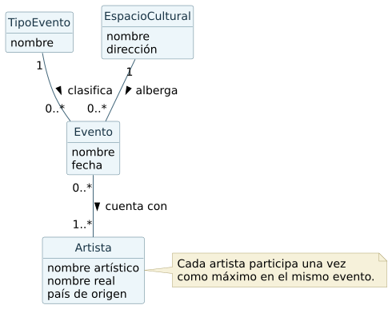
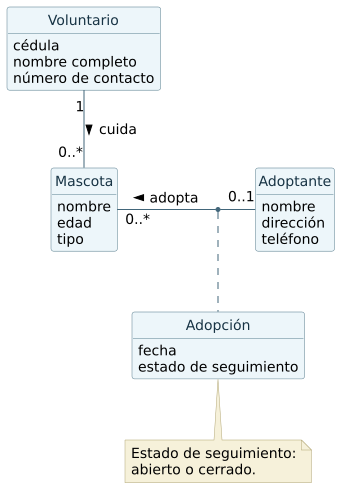
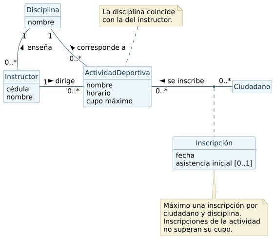

# Ejercicios de análisis orientado a objetos

Programación 2 · Práctico 2.4, p. 1.

## 1. Eventos culturales

- Evento registra nombre y fecha. Cada evento pertenece a un TipoEvento y se realiza en un EspacioCultural. Un tipo y un espacio pueden estar asociados con cero o muchos eventos.
- Cada espacio registra nombre y dirección. Cada Artista registra nombre artístico, nombre real y país de origen.
- Un evento debe contar con uno o más artistas. Un artista puede participar en cero o muchos eventos. Se admite un artista registrado que aún carece de eventos asignados.
- La participación de un artista en un mismo evento se registra una sola vez. Si interesa impedir que dos eventos compartan espacio y horario, primero habría que incorporar hora y duración al modelo.

## 2. Rescate y adopción de animales

- Mascota guarda nombre, edad y tipo. Se usa el tipo como dato porque perro, gato y otros animales comparten los mismos datos y relaciones del enunciado.
- Cada mascota tiene exactamente un Voluntario a cargo. Cada voluntario puede cuidar cero o muchas mascotas. Se registra su cédula, nombre completo y número de contacto.
- Una mascota puede estar sin adoptar o tener un Adoptante. Cada adoptante puede adoptar cero o muchas mascotas. Se guarda nombre, dirección y teléfono.
- Adopción es una clase de asociación. Su fecha y estado de seguimiento corresponden a una mascota adoptada por una persona concreta. El estado es abierto o cerrado. Una mascota sin adoptante carece de una adopción y, por lo tanto, de estado de seguimiento.

## 3. Inscripciones deportivas

- ActividadDeportiva tiene nombre, horario y cupo máximo. Cada actividad corresponde a una Disciplina y tiene un Instructor responsable. Cada instructor tiene cédula, nombre y una disciplina que enseña. La disciplina de la actividad coincide con la del instructor.
- Un Ciudadano puede inscribirse a varias actividades. La clase de asociación Inscripción guarda la fecha y la asistencia al primer encuentro. La asistencia queda sin registrar hasta el encuentro y luego toma el valor sí o no.
- Un ciudadano puede tener como máximo una inscripción por disciplina. Si ya se inscribió en fútbol de mañana, se rechaza una inscripción a fútbol de tarde y puede inscribirse a natación.
- El cupo máximo debe ser positivo. El total de inscripciones de una actividad no supera ese valor. El límite depende de cada actividad, por eso se expresa como una restricción adicional a la multiplicidad.

En [diagramas](diagramas/) están las imágenes y los archivos PlantUML editables.
