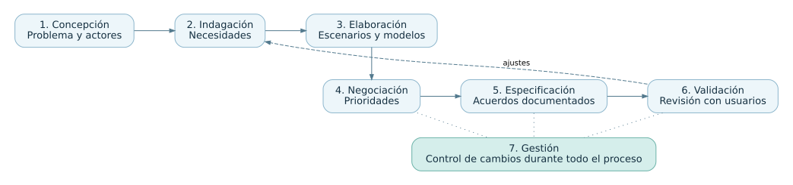

# Comprensión de los requerimientos

Resumen de Roger S. Pressman, *Ingeniería del software. Un enfoque práctico*, 7.ª edición, capítulo 5.

Entender los requerimientos implica descubrir qué problema tienen las personas, qué esperan del sistema y qué restricciones afectan el proyecto. Conviene precisar la necesidad antes de decidir el diseño. Por ejemplo, «quiero que me tome preguntas» todavía deja por definir quién prepara el banco, cómo se eligen las preguntas y qué se muestra al finalizar.

## Del problema al acuerdo

| Tarea | Aplicación al sistema de repaso |
| --- | --- |
| Inicio o concepción | Identificar al docente y a los estudiantes, el propósito del repaso y los límites de la primera entrega. |
| Indagación u obtención | Entrevistar a los dos grupos para conocer sus necesidades, observar cómo hacen un repaso hoy y pedir ejemplos concretos. |
| Elaboración | Construir escenarios y un modelo sencillo con preguntas, opciones, sesiones y resultados para detectar omisiones. |
| Negociación | Acordar qué funciones entran primero si el grupo quiere filtros, historial y devolución detallada al mismo tiempo. |
| Especificación | Dejar por escrito los requisitos acordados, las reglas y los criterios que permiten probarlos. |
| Validación | Revisar el documento con quienes lo usarán y comprobar que los requisitos estén completos, sean coherentes y se puedan verificar. |
| Gestión | Identificar cada requisito y seguir sus cambios. Si cambia la cantidad de opciones, revisar el formulario, los datos y las pruebas. |

Estas tareas se superponen. Si al escribir un escenario aparece una duda, se vuelve a consultar a quien conoce el trabajo y se actualiza el documento.

## Cómo obtener y organizar la información

Las reuniones permiten comparar los puntos de vista de quienes usan el sistema y de quienes lo mantienen. Los escenarios ayudan a describir qué hace cada persona, cómo responde el sistema y qué puede salir mal. El capítulo también presenta el despliegue de la función de calidad (QFD), que relaciona las necesidades de los interesados con las características del producto. Distingue lo que se pide expresamente, lo que el usuario da por supuesto y las mejoras que podrían aportar una satisfacción adicional. En el repaso, elegir la cantidad de preguntas se pidió expresamente. Que el resultado coincida con las respuestas es una expectativa básica.

La elaboración conecta escenarios con información del dominio. Por ejemplo, al detallar una sesión se ve que el sistema debe conocer qué preguntas presentó y qué opción eligió el estudiante. Así se puede discutir si una edición del banco afecta una sesión que ya empezó.

## Cómo comprobar lo acordado

Un requisito como «las preguntas salen bien mezcladas» da lugar a interpretaciones distintas. Una forma de precisarlo es acordar que se seleccionen tantas preguntas como pidió el estudiante, sin repetir ninguna en la misma sesión y siempre a partir del banco disponible. Durante la validación también se revisa qué ocurre cuando el banco tiene menos preguntas que las solicitadas.

Cada cambio se registra con su motivo y con los escenarios o pruebas que deben revisarse. Si se decide guardar resultados de varias sesiones, habrá que definir cuáles se conservan y quién los puede consultar.

## Referencias

- Pressman, R. S. (2010). *Software Engineering. A Practitioner's Approach* (7.ª ed.). McGraw-Hill. [Capítulo 5, edición en inglés](https://mlsu.ac.in/econtents/16_EBOOK-7th_ed_software_engineering_a_practitioners_approach_by_roger_s._pressman_.pdf)
- Pressman, R. S. (2009). *Understanding Requirements* [diapositivas del capítulo 5](https://www.se.rit.edu/~se361/Slides/se361_Chapter_05.pdf).

Las figuras son esquemas propios aplicados al caso de la actividad.
